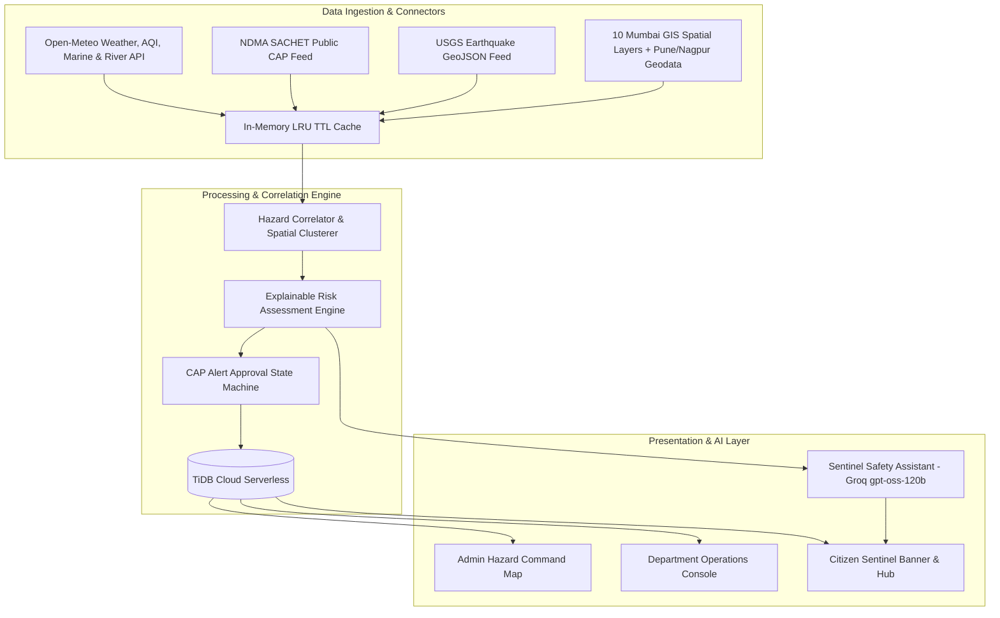

# Sentinel City Intelligence — Multi-Hazard Early Warning & Civic Command Platform

> An AI-powered, multi-hazard early warning and urban intelligence platform extending **Urban Link** across **Mumbai (BMC)**, **Pune (PMC)**, and **Nagpur (NMC)**. Grounded in verified telemetry, municipal spatial assets, and official disaster control protocols.

---

## 🏛️ System Overview

**Sentinel City Intelligence** bridges real-time environmental earth observation (Doppler radar precipitation, air quality index, river discharge, coastal storm surge, seismology) with municipal emergency response and citizen civic management.

### Key Capabilities
- **Citizen Safety Hub (`/[city]/sentinel`)**: Real-time localized weather and environmental condition cards, direct hotlines to municipal emergency cells, verified disaster shelter locators, and a conversational **Sentinel Safety Assistant** powered by Groq (`openai/gpt-oss-120b`).
- **Admin Command Centre (`/admin/[city]`)**: Unified city command overview with live multi-hazard risk scoring, connector health monitoring, and priority incident triage.
- **Geospatial Incident & Hazard Map (`/admin/[city]/map`)**: Leaflet map supporting 5 basemap providers, live weather tickers, and toggleable vector layers (35 Mumbai recurrent flood hotspots, 15 terrain depression basins, 88 km arterial drainage nullahs, and coastal surge zones).
- **Human-in-the-Loop Alert Review Modal (`?tab=alerts`)**: CAP-compliant administrative review and broadcast engine before sirens or push notifications are dispatched.
- **Monsoon Downpour Simulation Engine (`?tab=simulation`)**: Hydrological stress-test module evaluating 25, 50, and 85 mm/h downpours against actual terrain slope and drainage bottlenecks, watermarked with `[SIMULATION SCENARIO]`.
- **Department Operations Console (`/department/[city]/[dept]`)**: Tailored operational context (e.g. Drainage Roster Protocol, rainfall thresholds, and pumping station inspection rules) preserving existing ticket desks and shift dispatchers.
- **Preserved Urban Link Core**: 53 original routes, citizen incident reporting wizard, AssemblyAI voice input, 17 department desks, and worker shift dispatch remain 100% operational with 0 regressions.

---

## 🏗️ Architecture



---

## 🚀 Quick Start & Installation

### Prerequisites
- **Node.js**: v20.x or v22.x+
- **Package Manager**: `npm`
- **Database**: TiDB Cloud Serverless (or local MySQL 8.0+)

### 1. Clone & Install Dependencies
```bash
# Clone the repository
git clone <your-repository-url>
cd sentinel-city-intelligence

# Install npm dependencies
npm install
```

### 2. Environment Configuration
Copy the template file to `.env.local` and configure your credentials:
```bash
cp .env.example .env.local
```

Key variables:
- `DATABASE_HOST`, `DATABASE_USER`, `DATABASE_PASSWORD`: TiDB Cloud connection details.
- `GROQ_API_KEY`: Groq API key for Sentinel Multi-Hazard RAG Assistant.
- `GROQ_LLAMA_API_KEY`: Groq API key for Citizen reporting categorization wizard.
- `NEXT_PUBLIC_APP_URL`: `http://localhost:3000` (Local) or your production domain.
- `NEXTAUTH_SECRET`: Random 32-byte base64 secret (`openssl rand -base64 32`).

### 3. Database Migration
Run the automated migration script to provision the 8 Sentinel multi-hazard tables in TiDB:
```bash
node scripts/migrate-hazards.mjs
```

### 4. Normalize Geodata
Ensure Pune custom JSONs are normalized into standard GeoJSON:
```bash
node scripts/normalize-pune-geojson.mjs
```

### 5. Launch Development Server
```bash
npm run dev
```
Open [http://localhost:3000](http://localhost:3000) in your browser.

---

## 🧪 Testing & Verification

Run the automated Phase 6 regression and security test suite:
```bash
node scripts/run-phase6-tests.mjs
```
*Current Suite Status:* **29 / 29 Tests Passing (100%)**

### Capture Headless UI Screenshots
To take authentic screenshots across desktop (1280x800) and mobile (390x844) viewports:
```bash
node scripts/capture-all-screenshots.mjs
node scripts/capture-modals.mjs
```
Output images are stored in `public/screenshots/`.

---

## 🗺️ City Context & Jurisdiction Routing

| City Slug | Municipal Corporation | Center Coordinates | Helpline | Primary Monitored Hazards |
|:---|:---|:---:|:---:|:---|
| `mumbai` | Brihanmumbai Municipal Corporation (BMC) | `[19.0760, 72.8777]` | `1916` | Urban Pluvial Flooding, Arabian Sea Surge, River Surcharge (Mithi), Air Quality |
| `pune` | Pune Municipal Corporation (PMC) | `[18.5204, 73.8567]` | `020-25501000` | Riverine Flooding (Mutha/Mula), Drainage Bottlenecks, Air Quality |
| `nagpur` | Nagpur Municipal Corporation (NMC) | `[21.1458, 79.0882]` | `0712-2567011` | Urban Heat Waves, Severe Storms, Air Quality |

---

## 🔒 Security & AI Anti-Hallucination Policy

1. **Strict City Boundary Isolation**: Map layers, hazard evaluations, and emergency helplines are compartmentalized server-side by city slug. Mumbai GIS layers cannot leak into Pune or Nagpur views.
2. **Retrieval-Augmented Grounding**: Sentinel AI responses are grounded exclusively in verified real-time telemetry, official CAP advisories, and municipal assets. The assistant explicitly disclaims unverified rumors and never fabricates emergency numbers or evacuations.
3. **Illustrative Simulation Safeguards**: All synthetic downpour stress-tests are watermarked with `[SIMULATION SCENARIO]` to prevent misinterpretation as validated real-time forecasts.
4. **Credential Privacy**: Client components do not bundle or expose database credentials, Groq tokens, or private VAPID keys.

---

## 📄 Documentation Index
- [System Architecture Specification](docs/SYSTEM_ARCHITECTURE_PHASE3.md)
- [Data Engineering Plan](docs/DATA_ENGINEERING_PLAN_PHASE2.md)
- [Master Project Audit](docs/PROJECT_AUDIT_PHASE1.md)
- [UI & Geospatial Screenshot Review](docs/UI_SCREENSHOT_INDEX_PHASE5.md)
- [Credential & Dataset Checklist](docs/CREDENTIAL_AND_DATASET_CHECKLIST.md)
- [Final Data Asset Inventory](docs/FINAL_DATA_INVENTORY.md)
- [Continuous Progress Tracker](docs/PROGRESS.md)

---

## ⚖️ License & Attribution
- Built upon **Urban Link Civic Management System**.
- Map Tiles & Data: &copy; [OpenStreetMap](https://www.openstreetmap.org/copyright) contributors, [CARTO](https://carto.com/).
- Elevation Data: [Copernicus GLO-30 DEM](https://spacedata.copernicus.eu/), European Space Agency (ESA).
- Weather & Marine: [Open-Meteo](https://open-meteo.com/) (CC-BY 4.0 / Open Data).
- Disaster Alerts: [National Disaster Management Authority (NDMA) SACHET](https://sachet.ndma.gov.in/).
- Earthquake Feeds: [USGS Hazards Program](https://earthquake.usgs.gov/).
- Municipal Geodata: MCGM (BMC), PMC, and NMC Open Data Portals.
