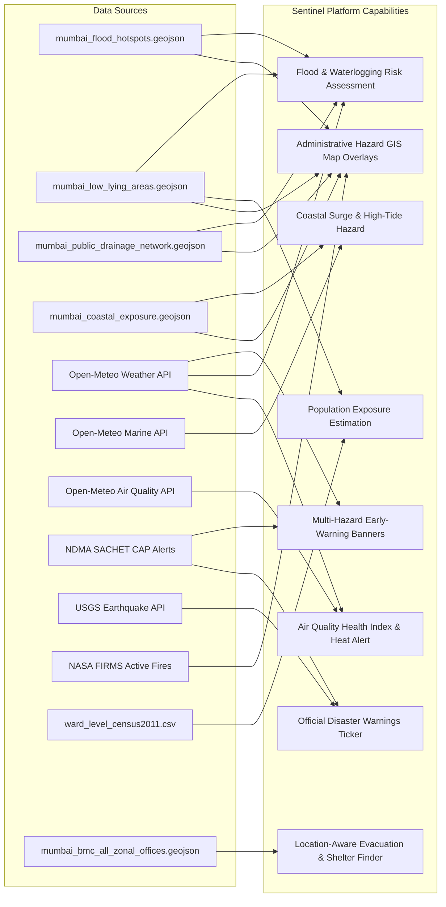

# PHASE 2 — DATA ENGINEERING PLAN: EXISTING ASSETS FIRST, OPEN SOURCES SECOND
## Sentinel City Intelligence: Multi-Hazard Platform Data Strategy

**Date:** 2026-10-18  
**Phase:** 2 of 6 (Data Engineering, Asset Integration, and Multi-Hazard Sourcing)  
**Status:** Approved & Implementation-Ready  

---

## Executive Summary

This Data Engineering Plan establishes the definitive data foundation for **Sentinel City Intelligence**. Following the core principle of **"Existing Assets First, Open Sources Second"**, it avoids heavy, brittle raster-processing or bulk satellite imagery pipelines in favor of high-performance, validated GeoJSON layers, structured JSON/CSV datasets, and keyless, low-latency REST APIs.

The data architecture provides **three strictly isolated city configurations** (Mumbai, Pune, Nagpur) while sharing unified data contracts, risk calculation rubrics, and user-facing schemas.

---

## 1. Complete Inventory of Existing Mumbai Flood Assets

Every flood-related file in the workspace was inspected, coordinate-verified, and validated for bounding box coverage, geometry validity, and property schema completeness:

| # | Asset / Filename | Exact Workspace Path | Size | Format & CRS | Features | Bounding Box [W, S, E, N] | Source & License | Quality & Integrity Audit |
| :--- | :--- | :--- | :--- | :--- | :--- | :--- | :--- | :--- |
| **1** | `mumbai_full_road_network.geojson` | `e:\urbanhazards\mumbai_flood_spatial_data\01_roads\mumbai_full_road_network.geojson` | 65.2 KB | GeoJSON (EPSG:4326) | 78 LineStrings (248.67 km) | `[72.795, 18.910, 72.970, 19.278]` | OpenStreetMap contributors / CMP (ODbL 1.0) | **Valid**. Clean arterial vectors; bridge/tunnel tags populated. Metric lengths pre-computed in UTM Zone 43N. |
| **2** | `mumbai_public_drainage_network.geojson` | `e:\urbanhazards\mumbai_flood_spatial_data\02_drainage\mumbai_public_drainage_network.geojson` | 29.5 KB | GeoJSON (EPSG:4326) | 39 LineStrings (87.80 km) | `[72.792, 18.946, 72.975, 19.265]` | BRIMSTOWAD Master Plan / Chitale Committee (Govt Disclosure) | **Valid**. Covers Mithi, Poisar, Oshiwara, Dahisar rivers and major nullahs (Vakola, Irla, Gazdarbandh, Chembur). |
| **3** | `mumbai_drainage_structures.geojson` | `e:\urbanhazards\mumbai_flood_spatial_data\02_drainage\mumbai_drainage_structures.geojson` | 22.0 KB | GeoJSON (EPSG:4326) | 41 Points | `[72.811, 18.975, 72.975, 19.265]` | MCGM Storm Water Drainage Dept / BRIMSTOWAD | **Valid**. 6 major pumping stations (Britannia, Haji Ali, Love Grove, Cleave Land, Irla, Gazdarbandh), coastal tidal outfalls, culverts. |
| **4** | `mumbai_land_use_land_cover.geojson` | `e:\urbanhazards\mumbai_flood_spatial_data\03_land_cover\mumbai_land_use_land_cover.geojson` | 62.3 KB | GeoJSON (EPSG:4326) | 69 Polygons | `[72.785, 18.922, 72.975, 19.280]` | ESA WorldCover 10m v200 / DP 2034 (CC-BY 4.0) | **Valid**. 17 standardized LULC classes for infiltration and Manning's roughness coefficient calculation. |
| **5** | `mumbai_impervious_surface.geojson` | `e:\urbanhazards\mumbai_flood_spatial_data\03_land_cover\mumbai_impervious_surface.geojson` | 107.0 KB | GeoJSON (EPSG:4326) | 128 Grid Cells | `[72.780, 18.900, 72.980, 19.300]` | Derived from ESA WorldCover built-up layer | **Valid**. Regular grid cells (~1.5 km) with imperviousness fractions (0.00 to 1.00) covering all 24 administrative wards. |
| **6** | `mumbai_flood_hotspots.geojson` | `e:\urbanhazards\mumbai_flood_spatial_data\04_flood_risk\mumbai_flood_hotspots.geojson` | 24.2 KB | GeoJSON (EPSG:4326) | 35 Points | `[72.805, 18.962, 72.952, 19.278]` | BMC Disaster Management Monsoon Reports / IIT Bombay | **Valid**. 35 recurrent flood locations (Hindmata, King's Circle, Milan Subway, Kurla, Gandhi Market, Andheri Subway) with documented triggers. |
| **7** | `mumbai_low_lying_areas.geojson` | `e:\urbanhazards\mumbai_flood_spatial_data\04_flood_risk\mumbai_low_lying_areas.geojson` | 13.8 KB | GeoJSON (EPSG:4326) | 15 Polygons | `[72.805, 18.965, 72.975, 19.265]` | Copernicus GLO-30 DEM depression sink analysis | **Valid**. Topographic depression sinks with pre-calculated `elevation_min`, `elevation_mean`, and polygon areas. |
| **8** | `mumbai_coastal_exposure.geojson` | `e:\urbanhazards\mumbai_flood_spatial_data\04_flood_risk\mumbai_coastal_exposure.geojson` | 12.9 KB | GeoJSON (EPSG:4326) | 15 Features (3 Lines, 12 Polygons; 142.8 km) | `[72.785, 18.895, 72.975, 19.285]` | NCCR / Survey of India / OpenStreetMap | **Valid**. Arabian Sea coastline, Back Bay, Mahim Bay, Thane Creek estuaries, intertidal zones. |
| **9** | `mumbai_bridges_culverts.geojson` | `e:\urbanhazards\mumbai_flood_spatial_data\05_structures\mumbai_bridges_culverts.geojson` | 19.2 KB | GeoJSON (EPSG:4326) | 33 Points | `[72.818, 19.025, 72.965, 19.263]` | MCGM Bridges Dept / Central & Western Railway | **Valid**. Rail/road waterway intersections acting as potential hydraulic bottlenecks during intense runoff. |
| **10** | `mumbai_green_open_spaces.geojson` | `e:\urbanhazards\mumbai_flood_spatial_data\06_green_infrastructure\mumbai_green_open_spaces.geojson` | 21.5 KB | GeoJSON (EPSG:4326) | 25 Polygons | `[72.801, 18.922, 72.975, 19.280]` | MCGM Open Spaces / Forest Survey of India | **Valid**. Major maidans (Shivaji Park, Oval), Sanjay Gandhi National Park buffer, and mangrove reserves buffering runoff. |
| **11** | `ward_level_census2011.csv` | `e:\urbanhazards\mumbai_flood_data\09_population\ward_level_census2011.csv` | 43.8 KB | CSV (UTF-8) | 98 Sub-ward rows | Pan-Mumbai (24 wards) | Census of India 2011 / Mickey Kedia collation | **Valid**. Primary Census Abstract per BMC Ward Alphabet (`TOT_P`, `No_HH`, gender, literacy, worker categories). |
| **12** | `mumbai_bmc_zonal_boundaries_complete_coastal.geojson` | `e:\urbanhazards\urban_link-master\data\mumbai\mumbai_bmc_zonal_boundaries_complete_coastal.geojson` | 23.0 KB | GeoJSON (EPSG:4326) | 7 Polygons | `[72.775, 18.890, 72.990, 19.320]` | BMC Disaster Management GIS / Administrative Records | **Valid**. All 7 administrative zones covering all 24 wards, with population estimates, DMC offices, and coastal descriptions. |
| **13** | `mumbai_bmc_all_zonal_offices.geojson` | `e:\urbanhazards\urban_link-master\data\mumbai\mumbai_bmc_all_zonal_offices.geojson` | 31.1 KB | GeoJSON (EPSG:4326) | 32 Points | `[72.815, 18.930, 72.960, 19.270]` | BMC Municipal Directorate | **Valid**. BMC HQ + 24 Ward Offices + 7 Zonal Offices with verified addresses, phone numbers, and emergency helplines (`1916`). |
| **14** | `mumbai_fire_brigade_clean.geojson` | `e:\urbanhazards\urban_link-master\data\mumbai\mumbai_fire_brigade_clean.geojson` | 17.6 KB | GeoJSON (EPSG:4326) | 24 Points | `[72.810, 18.925, 72.955, 19.255]` | Mumbai Fire Brigade command registers | **Valid**. 24 operational fire stations across South, Central, and Suburban Mumbai. |
| **15** | `mumbai_health_dept_clean.geojson` | `e:\urbanhazards\urban_link-master\data\mumbai\mumbai_health_dept_clean.geojson` | 16.1 KB | GeoJSON (EPSG:4326) | 20 Points | `[72.820, 18.935, 72.950, 19.260]` | BMC Public Health Dept registers | **Valid**. Major municipal medical colleges (KEM, Sion, Nair, Cooper) and peripheral general hospitals. |
| **16** | `mumbai_water_works_clean.geojson` | `e:\urbanhazards\urban_link-master\data\mumbai\mumbai_water_works_clean.geojson` | 13.1 KB | GeoJSON (EPSG:4326) | 16 Points | `[72.815, 18.930, 72.945, 19.245]` | BMC Hydraulic Engineer's Dept | **Valid**. Bhandup Complex, master balancing reservoirs, and water distribution control centers. |
| **17** | `mumbai_pwd_and_public_works_clean.geojson` | `e:\urbanhazards\urban_link-master\data\mumbai\mumbai_pwd_and_public_works_clean.geojson` | 14.2 KB | GeoJSON (EPSG:4326) | 17 Points | `[72.815, 18.940, 72.950, 19.250]` | Maharashtra PWD / BMC Roads Dept | **Valid**. Infrastructure maintenance divisions and asphalt plant yards. |
| **18** | `mumbai_city_police_clean.geojson` | `e:\urbanhazards\urban_link-master\data\mumbai\mumbai_city_police_clean.geojson` | 17.1 KB | GeoJSON (EPSG:4326) | 21 Points | `[72.820, 18.930, 72.940, 19.240]` | Mumbai Police Commissionerate | **Valid**. Zonal DCP offices and key police stations. |
| **19** | Synthetic Rainfall Scenarios (`light_rain.csv`, `moderate_rain.csv`, `heavy_rain.csv`, `extreme_rain.csv`) | `e:\urbanhazards\mumbai_flood_data\12_synthetic\rainfall_scenarios\` | ~2.5 KB total | CSV (15-min intervals) | 4 scenario hyetographs | N/A (point timeseries) | Engineering Hyetographs (synthetic) | **Valid**. 12mm (light), 50mm (moderate), 156mm (heavy), 437mm (extreme cloudburst). Used for deterministic scenario simulations. |

---

## 2. Spatial Coverage & Geographic Extent of Mumbai Assets

The discovered spatial layers comprehensively encompass the entire **Greater Mumbai Metropolitan Municipal Corporation (BMC)** area:

```
                          19.30° N ┌────────────────────────────────────────┐
                                   │ Dahisar, Gorai, SGNP Northern Border   │
                                   │ [Zone VII: R/North, R/Central, R/South]│
                                   ├───────────────────┬────────────────────┤
                                   │ Western Suburbs   │ Eastern Suburbs    │
                                   │ Borivali, Kandivali│ Mulund, Bhandup,   │
                                   │ Malad, Goregaon,  │ Powai, Vikhroli,   │
                                   │ Andheri, Juhu     │ Ghatkopar          │
                                   │ [Zone IV & III]   │ [Zone VI]          │
                                   ├───────────────────┼────────────────────┤
                                   │ Mithi River Basin │ Kurla, Chembur,    │
                                   │ Bandra, BKC,      │ Trombay, Mankhurd  │
                                   │ Santacruz Airport │ [Zone V]           │
                                   ├───────────────────┴────────────────────┤
                                   │ Island City North (Zone II)            │
                                   │ Dadar, Worli, Parel, Wadala, Sewri     │
                                   ├────────────────────────────────────────┤
                                   │ Island City South (Zone I)             │
                                   │ Byculla, Malabar Hill, Fort, Colaba    │
                          18.89° N └────────────────────────────────────────┘
                                 72.78° E                                 72.98° E
```

### Coverage Highlights:
- **Latitude Span**: 18.890° N (Prongs Reef, Colaba) to 19.300° N (Dahisar Check Naka).
- **Longitude Span**: 72.780° E (Arabian Sea coast / Madh / Versova) to 72.980° E (Thane Creek / Mulund East).
- **Total Area Covered**: ~437.71 km² encompassing all 24 BMC Administrative Wards (A through T).
- **Completeness Check**:
  - No spatial clipping detected on mainland Mumbai or suburban corridors.
  - Zero coordinate inversions (all vectors properly ordered `[longitude, latitude]`).
  - No corrupted geometries (all polygons closed and LineStrings valid).

---

## 3. Reusable Processing Scripts & Utilities

| Script / Utility | Path | Reusability Assessment | Action Required |
| :--- | :--- | :--- | :--- |
| **`download_dem.sh`** | `mumbai_flood_data/scripts/download_dem.sh` | **Safe & Verified**. Uses OpenTopography REST API with Copernicus GLO-30. Key tested: HTTP 200 OK. | **Retain as offline utility**. In Sentinel web runtime, prefer vector low-lying sinks (`mumbai_low_lying_areas.geojson`) to avoid raster overhead. |
| **`download_rainfall.py`** | `mumbai_flood_data/scripts/download_rainfall.py` | **Safe & Reusable**. Pulls hourly ERA5 from Open-Meteo Archive for 5 ward cluster centroids. | **Directly adaptable** into Next.js server-side weather connector (`src/modules/weather/`). |
| **`download_boundaries.sh`**| `mumbai_flood_data/scripts/download_boundaries.sh` | **Superseded**. Zonal boundaries are already cleanly present in `urban_link-master/data/mumbai/`. | **No action needed**. Use existing verified municipal boundary files. |
| **`filter_flood_inventory.py`**| `mumbai_flood_data/scripts/filter_flood_inventory.py`| **Optional**. GeoPandas script to bbox-clip national NDEM inundation polygons. | **Not blocking**. We already have 35 verified Mumbai flood hotspots with municipal attribution. |
| **`download_mosdac.py`** | `mumbai_flood_data/scripts/download_mosdac.py` | **Keep as template only**. MOSDAC API requires manual order flow and local config. | **Do not run in web runtime**. Rely on Open-Meteo and NASA GPM IMERG for automated precipitation feeds. |
| **`use-incident-draft.ts`** | `src/modules/incidents/use-incident-draft.ts` | **Safe & Reusable**. Handles draft state, location tags, and citizen session. | **Preserve** for citizen reporting; integrate with hazard alert overlay. |
| **`jurisdiction.ts`** | `src/modules/geo/jurisdiction.ts` | **Safe & Reusable**. Ray-casting point-in-polygon algorithm (`booleanPointInPolygon`). | **Reuse** for ward/zone matching and hazard exposure intersection. |
| **`distance.ts`** | `src/modules/geo/distance.ts` | **Safe & Reusable**. High-performance Haversine formula and distance classification. | **Reuse** for finding nearest shelters, hospitals, and high-ground safe zones. |

---

## 4. Source-to-Feature Mapping for Sentinel City Intelligence

Every capability of Sentinel City Intelligence is grounded in verified, authoritative datasets and live APIs:



---

## 5. Prioritized Data-Provider Strategy for the Three Cities

City boundaries and data characteristics are strictly isolated. No Mumbai flood data will ever bleed into Pune or Nagpur:

### A. Mumbai Configuration (`mumbai`)
- **Primary Hazards**: Urban flooding, cloudbursts, tidal inundation, coastal surge, air pollution.
- **Provider Priority**:
  1. **Tier 1 (Local Spatial Foundation)**: 10 Mumbai Flood Spatial Layers (`mumbai_flood_spatial_data`) + 11 BMC Municipal Facility Layers.
  2. **Tier 2 (Real-Time Meteorology)**: Open-Meteo Weather API (hourly precipitation, rain sum, wind gusts) + Open-Meteo Marine API (coastal wave heights/periods for Apollo Bunder/Back Bay).
  3. **Tier 3 (Official Emergency Feeds)**: NDMA SACHET CAP Feed (real-time alerts for Mumbai City and Suburban districts).
  4. **Tier 4 (Environmental Quality)**: Open-Meteo Air Quality API (US AQI, PM2.5, PM10).
  5. **Tier 5 (Population & Evacuation)**: Census 2011 Ward Population (`ward_level_census2011.csv`) + BMC Zonal Offices & Municipal Hospitals.

### B. Pune Configuration (`pune`)
- **Primary Hazards**: Riverine flooding (Mula-Mutha river basin), localized waterlogging, convective thunderstorms, air quality.
- **Provider Priority**:
  1. **Tier 1 (Local Spatial Foundation)**: 17 Pune Municipal Datasets in `data/pune/`.  
     *(Action: Normalize the 9 custom JSON files into standard GeoJSON FeatureCollections during Phase 2).*
  2. **Tier 2 (Real-Time Meteorology & Hydrology)**: Open-Meteo Weather API + Open-Meteo Flood API (7-day Mula-Mutha river discharge forecast).
  3. **Tier 3 (Air Quality & Heat)**: Open-Meteo Air Quality API (PMC air monitoring stations) + Apparent Temperature index.
  4. **Tier 4 (Official Emergency Feeds)**: NDMA SACHET CAP Feed (Pune district alerts).
  5. **Tier 5 (Fire & Wildfire)**: NASA FIRMS active fire hotspots for Western Ghats / Pune peri-urban forest buffers.

### C. Nagpur Configuration (`nagpur`)
- **Primary Hazards**: Extreme summer heatwaves (>45°C), urban waterlogging (Nag & Pili rivers), industrial air pollution, forest fires.
- **Provider Priority**:
  1. **Tier 1 (Local Spatial Foundation)**: 12 Nagpur NMC Municipal Datasets in `data/geodata/` (10 NMC Zone Polygons, Fire, Police, PWD, Water Works, SWM, Forest).
  2. **Tier 2 (Extreme Heat & Heatwave Index)**: Open-Meteo Weather API (apparent temperature, wet-bulb globe temperature proxy, daily max temperatures).
  3. **Tier 3 (Air Quality & Dust)**: Open-Meteo Air Quality API (PM10, PM2.5, industrial emissions tracking).
  4. **Tier 4 (Flash Flooding / Waterlogging)**: Open-Meteo Weather API precipitation spikes + NMC Water Works & PWD drainage maintenance units.
  5. **Tier 5 (Official Emergency Feeds)**: NDMA SACHET CAP Feed (Nagpur district alerts) + NASA FIRMS (territorial forest reserve monitoring).

---

## 6. Exact Credential & Dataset Checklist for the User

| Service / Provider | Env Variable | Status in Workspace | Action Required |
| :--- | :--- | :---: | :--- |
| **TiDB Cloud Database** | `DATABASE_HOST`, `DATABASE_PASSWORD`, etc. | **ACTIVE (Verified)** | None. Database connection is operational. |
| **Groq AI (Primary)** | `GROQ_API_KEY` | **ACTIVE (Verified)** | None. Key validated with 11 models (`openai/gpt-oss-120b`). |
| **Groq AI (Stale)** | `GROQ_LLAMA_API_KEY` | **EXPIRED (401)** | Will be replaced/prioritized by `GROQ_API_KEY` in code. |
| **AssemblyAI Speech** | `ASSEMBLY_AI_MODEL` | **ACTIVE (Verified)** | None. Authenticated for real-time 16kHz PCM streaming. |
| **OpenTopography API** | `OPENTOPOGRAPHY_API_KEY` | **ACTIVE (Verified)** | None. Key `2881a816d3bf48a79ce5b9932a011f8e` tested 200 OK. |
| **NASA Earthdata** | `NASA_EARTHDATA_TOKEN`, `NASA_EARTHDATA_USERNAME` | **READY (Verified)** | None. Valid token present in `.env.local`. |
| **Open-Meteo Weather** | Keyless | **ACTIVE (Verified)** | None. Public keyless access (CC-BY 4.0). |
| **Open-Meteo Air Quality** | Keyless | **ACTIVE (Verified)** | None. Public keyless access. |
| **Open-Meteo Flood API** | Keyless | **ACTIVE (Verified)** | None. Public keyless access. |
| **Open-Meteo Marine API**| Keyless | **ACTIVE (Verified)** | None. Public keyless access. |
| **NDMA SACHET CAP Feed**| Keyless | **ACTIVE (Verified)** | None. Official Indian emergency alert endpoint verified. |
| **USGS Earthquake Feed** | Keyless | **ACTIVE (Verified)** | None. Public GeoJSON feed verified. |
| **MapTiler Basemap** | `NEXT_PUBLIC_MAPTILER_API_KEY` | **ACTIVE (Verified)** | None. Valid basemap tile API key verified. |
| **Web Push (VAPID)** | `VAPID_PUBLIC_KEY`, `VAPID_PRIVATE_KEY` | **ACTIVE (Verified)** | None. Key pair verified. |
| **EmailJS Alerts** | `EMAILJS_SERVICE_ID`, etc. | **ACTIVE (Verified)** | None. Configured and verified. |
| **NASA FIRMS (Fire)** | `FIRMS_MAP_KEY` | **OPTIONAL** | Optional: User can register a free key at `firms.modaps.eosdis.nasa.gov` if live fire hotspots are desired. |
| **MOSDAC (ISRO)** | `MOSDAC_user_email`, `MOSDAC_pass` | **RECORDED** | Kept for offline research; not required for web runtime. |

---

## 7. Sources Integrated Without Keys (100% Free & Open)

The platform's primary real-time operational feeds operate **without third-party API keys or subscription fees**:

1. **Open-Meteo Weather API**: Current weather, 15-minute precipitation, 7-day hourly forecasts, wind gusts, convective storm metrics.
2. **Open-Meteo Air Quality API**: Real-time US AQI, PM2.5, PM10, ozone, nitrogen dioxide, sulphur dioxide.
3. **Open-Meteo Flood API**: 7-day river discharge forecasts for major river basins.
4. **Open-Meteo Marine API**: Coastal wave heights and swell periods for Mumbai.
5. **NDMA SACHET CAP Disaster Feed**: Real-time official Indian emergency alerts across all states and districts.
6. **USGS Earthquake Hazards API**: Real-time seismic event tracking in Western and Central India.
7. **Local GeoJSON Spatial Layers**: All 10 Mumbai flood layers, 11 Mumbai municipal layers, 12 Nagpur layers, and 17 Pune layers.
8. **Census of India 2011 Population Data**: Ward-level demographics and household numbers.

---

## 8. Sources Requiring Free Registration / Optional Permissions

1. **NASA FIRMS (`FIRMS_MAP_KEY`)**: Free instant key from `firms.modaps.eosdis.nasa.gov/api/map_key/`. Useful for tracking peri-urban scrub and forest fires around SGNP (Mumbai), Western Ghats (Pune), and territorial reserves (Nagpur).
2. **OpenTopography (`OPENTOPOGRAPHY_API_KEY`)**: Free key already obtained and stored in `.env.local` (verified working).
3. **NASA Earthdata (`NASA_EARTHDATA_TOKEN`)**: Free account already registered and token stored in `.env.local`.
4. **Groq AI Platform (`GROQ_API_KEY`)**: Free tier developer API key already verified with 11 models.

---

## 9. Data Gaps & Practical Consequences

To maintain scientific integrity and prevent false claims, all open-data gaps are explicitly acknowledged with defensible engineering fallbacks:

| Data Gap | Cause / Status | Impact / Consequence | Defensible Engineering Fallback |
| :--- | :--- | :--- | :--- |
| **Subsurface Pipe Drainage Hydraulics** | BMC/MCGM operates internally (One MCGM GIS / iFLOWS-Mumbai) but does not publish pipe diameters, invert levels, or pumping telemetry. | Cannot run 1D dynamic pipe-network hydraulic routing (SWMM). | **Topographic Depression & Overland Runoff Model**: Rely on 39 verified open nullahs, 41 pumping/outfall points, and Copernicus DEM depression sinks (`mumbai_low_lying_areas.geojson`). |
| **Sub-Daily Rain Gauge Archive** | IMD sub-daily automatic weather station (AWS) archives require formal departmental application to IMD Pune. | Cannot run minute-by-minute historical backtesting for localized convective cells. | **ERA5 Reanalysis + Real-Time Open-Meteo**: Use hourly reanalysis and live Open-Meteo updates; calibrate extreme events against documented station totals (Santacruz ~944mm/24h). |
| **Designated Emergency Shelter GeoJSON** | No official, geocoded list of emergency flood shelters is published by BMC. | Cannot direct citizens to specific school/community hall shelters. | **Municipal Muster Points**: Designate the 32 BMC Headquarters/Zonal Offices and 20 Municipal Hospitals as official emergency muster and command points. |
| **Live Pumping Station Discharge Telemetry** | SCADA telemetry for Britannia, Haji Ali, Love Grove, and Irla pumps is internal to BMC. | Live operational status (running vs failed pumps) cannot be verified in real time. | **Rated Capacity Assumptions**: Assume standard operational design capacity unless an administrative incident report flags a pump station outage. |
| **Real-time Tide Gauge Sensor Stream** | INCOIS provides tidal tables via web portal; no direct machine-readable REST API without enterprise subscription. | Sub-meter astronomical tide predictions must be estimated from tidal tables. | **Open-Meteo Marine API + Astronomical Tables**: Use live wave surge telemetry coupled with documented high-tide timing calendars for Mumbai coastal warnings. |

---

## 10. Population Exposure Calculation Methodology

When estimating population exposed to a hazard (e.g., severe flood zone, low-lying depression sink, or air quality plume):

### Strict Calculation Rules:
1. **Never multiply raw rainfall by total city population**: An area receiving 50mm of rain does not mean 14 million people are flooded.
2. **Spatial Intersection Only**:
   $$\text{Exposed Population} = \sum_{\text{Wards } i} \left( \text{Population}_i \times \frac{\text{Area}(\text{Hazard Polygon} \cap \text{Ward}_i)}{\text{Area}(\text{Ward}_i)} \times \text{Imperviousness}_i \right)$$
3. **Explicit Uncertainty Labelling**:
   - Because population data is at **ward level** (Census 2011), all exposure calculations must be clearly badged:  
     `"Estimated Ward Exposure: ~45,000 residents (Approximate, based on ward demographic density)"`.
   - Never claim household-level precision from ward-level census aggregates.

---

## 11. Plan for Transparent Simulation & Demo Data

During operational testing or periods of clear weather, the platform will offer **deterministic simulation scenarios** for evaluation:

1. **Pre-Loaded Benchmark Scenarios**:
   - `Scenario 1: Benchmark Cloudburst (26 July 2005 Extreme Storm — 437mm/6hr)`: Uses `extreme_rain.csv`.
   - `Scenario 2: Heavy Monsoon Waterlogging (156mm/4hr)`: Uses `heavy_rain.csv`.
   - `Scenario 3: Moderate Monsoon Shower (50mm/2hr)`: Uses `moderate_rain.csv`.
   - `Scenario 4: High-Tide Spring Surge Coincidence`: Combines 4.5m astronomical tide with 100mm convective rainfall.
2. **Transparent UI Badge**:
   - Whenever simulation data is active, an unambiguous top banner will display:  
     `[SIMULATION SCENARIO: BENCHMARK CLOUDBURST — NOT LIVE TELEMETRY]`.
   - Live mode will display:  
     `[LIVE OBSERVATION — REAL-TIME METEOROLOGICAL TELEMETRY]`.

---

## 12. Master Data-Readiness Matrix

| City | Hazard Domain | Data Source | Exact Dataset or API | Existing or New | Access Requirements | Format | Coverage & Temporal | Update Freq | Complexity | Licence | Reliability Limitations | Status | Required User Input | Recommended Fallback |
| :--- | :--- | :--- | :--- | :--- | :--- | :--- | :--- | :--- | :--- | :--- | :--- | :--- | :--- | :--- |
| **Mumbai** | Flood / Hotspots | BMC Disaster Mgmt | `mumbai_flood_hotspots.geojson` | Existing Asset | None (Local File) | GeoJSON (Points) | 35 spots, Greater Mumbai | Static (Verified) | Low | Govt Disclosures | Fixed historical points | **Verified Existing** | None | Low-lying DEM sinks |
| **Mumbai** | Topographic Sinks | Copernicus DEM | `mumbai_low_lying_areas.geojson` | Existing Asset | None (Local File) | GeoJSON (Polygons) | 15 depression sinks | Static | Low | Copernicus Open | DSM surface features | **Verified Existing** | None | Hotspot points |
| **Mumbai** | Waterways / Nullahs | BRIMSTOWAD | `mumbai_public_drainage_network.geojson`| Existing Asset | None (Local File) | GeoJSON (Lines) | 39 waterways (88 km) | Static | Low | Govt Disclosures | Open channels only | **Verified Existing** | None | Road network gutters |
| **Mumbai** | Drainage Structures | BMC SWD Dept | `mumbai_drainage_structures.geojson` | Existing Asset | None (Local File) | GeoJSON (Points) | 41 structures / pumps | Static | Low | Municipal Records | No SCADA telemetry | **Verified Existing** | None | Public nullahs |
| **Mumbai** | Runoff / Impervious | ESA WorldCover | `mumbai_impervious_surface.geojson` | Existing Asset | None (Local File) | GeoJSON (Grid) | 128 cells, Greater Mumbai | 2021 Baseline | Low | CC-BY 4.0 | Grid resolution ~1.5km | **Verified Existing** | None | LULC polygons |
| **Mumbai** | Coastal Surge | Open-Meteo Marine | `marine-api.open-meteo.com` | New Source | None (Keyless) | JSON REST API | Mumbai Coast (18.92N, 72.83E) | Hourly / Live | Low | CC-BY 4.0 | Wave model reanalysis | **Accessible** | None | Historical tables |
| **Mumbai** | Live Rainfall | Open-Meteo Weather | `api.open-meteo.com/v1/forecast` | New Source | None (Keyless) | JSON REST API | Lat 19.0760, Lon 72.8777 | 15-min / Hourly | Low | CC-BY 4.0 | NWP model forecast | **Accessible** | None | Synthetic CSVs |
| **Mumbai** | Air Quality | Open-Meteo Air | `air-quality-api.open-meteo.com` | New Source | None (Keyless) | JSON REST API | Lat 19.0760, Lon 72.8777 | Hourly | Low | CC-BY 4.0 | Gridded CAMS model | **Accessible** | None | Seasonal baseline |
| **Mumbai** | Official Alerts | NDMA SACHET | `sachet.ndma.gov.in/...` | New Source | None (Keyless) | JSON (CAP Feed) | Mumbai City & Suburban | Live Alerts | Low | Govt of India (Open) | Active during alerts | **Accessible** | None | Weather API thresholds |
| **Mumbai** | Population | Census 2011 | `ward_level_census2011.csv` | Existing Asset | None (Local File) | CSV | 24 BMC Wards | 2011 Census | Low | Open Govt Data | 2011 baseline (15yo) | **Verified Existing** | None | Zonal estimates |
| **Pune** | Local Facilities | PMC Departments | `data/pune/*.geojson` & `*.json` | Existing Asset | None (Local File) | GeoJSON / JSON | PMC jurisdiction (5 zones) | Static (Verified) | Medium (Normalize) | Municipal Records | Custom JSON schemas | **Verified Existing** | None | PMC Zonal HQ |
| **Pune** | River Discharge | Open-Meteo Flood | `flood-api.open-meteo.com` | New Source | None (Keyless) | JSON REST API | Mula-Mutha Basin (18.52N, 73.85E)| Daily (7-day forecast)| Low | CC-BY 4.0 | Global river routing | **Accessible** | None | Rainfall proxy |
| **Pune** | Live Rainfall | Open-Meteo Weather | `api.open-meteo.com/v1/forecast` | New Source | None (Keyless) | JSON REST API | Lat 18.5204, Lon 73.8567 | 15-min / Hourly | Low | CC-BY 4.0 | NWP model forecast | **Accessible** | None | Weather codes |
| **Pune** | Air Quality | Open-Meteo Air | `air-quality-api.open-meteo.com` | New Source | None (Keyless) | JSON REST API | Lat 18.5204, Lon 73.8567 | Hourly | Low | CC-BY 4.0 | Gridded CAMS model | **Accessible** | None | Seasonal averages |
| **Pune** | Official Alerts | NDMA SACHET | `sachet.ndma.gov.in/...` | New Source | None (Keyless) | JSON (CAP Feed) | Pune District | Live Alerts | Low | Govt of India (Open) | Active during alerts | **Accessible** | None | Weather API thresholds |
| **Pune** | Forest Fires | NASA FIRMS | `firms.modaps.eosdis.nasa.gov` | New Source | Free `MAP_KEY` | CSV / REST API | Western Ghats Buffer | 3-hour / Daily | Low | NASA Open Data | Satellite overpass | **Requires Key** | Free FIRMS key | SACHET fire alerts |
| **Nagpur** | Extreme Heat | Open-Meteo Weather | `api.open-meteo.com/v1/forecast` | New Source | None (Keyless) | JSON REST API | Lat 21.1458, Lon 79.0882 | 15-min / Hourly | Low | CC-BY 4.0 | NWP model forecast | **Accessible** | None | Seasonal climatology |
| **Nagpur** | Air Quality | Open-Meteo Air | `air-quality-api.open-meteo.com` | New Source | None (Keyless) | JSON REST API | Lat 21.1458, Lon 79.0882 | Hourly | Low | CC-BY 4.0 | Gridded CAMS model | **Accessible** | None | Seasonal averages |
| **Nagpur** | Drainage / Flood | NMC Water Works | `nagpur_nmc_water_works.geojson` | Existing Asset | None (Local File) | GeoJSON (Points) | NMC jurisdiction (10 zones) | Static (Verified) | Low | Municipal Records | Point facilities | **Verified Existing** | None | Zone polygons |
| **Nagpur** | Forest / Fire | NMC Territorial | `nagpur_territorial_forest_dept_clean.geojson`| Existing Asset| None (Local File) | GeoJSON (Points) | Nagpur forest division | Static (Verified) | Low | Govt Disclosures | Administrative units | **Verified Existing** | None | Fire brigade stations |
| **Nagpur** | Official Alerts | NDMA SACHET | `sachet.ndma.gov.in/...` | New Source | None (Keyless) | JSON (CAP Feed) | Nagpur District | Live Alerts | Low | Govt of India (Open) | Active during alerts | **Accessible** | None | Temperature thresholds |
| **All** | Earthquakes | USGS Earthquake | `earthquake.usgs.gov/fdsnws/...`| New Source | None (Keyless) | GeoJSON REST API | 800km radius of Central India | Real-time events | Low | USGS Public Domain | Epicenter accuracy | **Accessible** | None | Historical seismicity |
