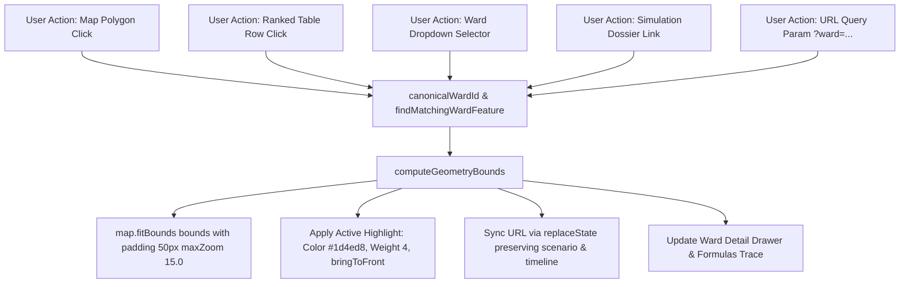

# SENTINEL CITY INTELLIGENCE — PHASE 2 GIS & SPATIAL INTERACTION AUDIT & REPAIR REPORT

**System:** Sentinel Multi-Hazard Early Warning & Incident Command Platform  
**Component:** GIS Identity, Polygon Navigation, Spatial Simulation Lab & Hazard Map  
**Status:** Complete, Verified & Production Built (`Exit Code 0`)  
**Auditor:** Senior GIS Engineer & Geospatial Frontend Architect  
**Documentation Version:** 2.0.0 — Phase 2 of 5  

---

## 1. Executive Summary

Phase 2 addressed critical spatial identity defects, broken polygon navigation, basemap failure, and aggressive marker clustering across the **Spatial Simulation Lab** (`/admin/[city]/simulation`) and the **Hazard and Incident Map** (`/admin/[city]/map`).

Prior to Phase 2:
1. Selecting wards frequently caused the Leaflet map to jump to hardcoded city center coordinates (`[19.0760, 72.8777]`) rather than framing the ward's actual geographic boundary.
2. Shorthand/alias discrepancies (e.g. `F/S` vs `F/South`, `Ward F/South`, `F-South`) caused `Array.prototype.find()` lookups to evaluate to `undefined` in simulation components, silently falling back to array index 0 (`Ward A`). This created the perception that polygon clicks were ignored or that the map selected the wrong area.
3. Complex administrative entities with non-contiguous landmasses (notably **Ward P/North**, encompassing Malad, Marve, and Madh Island) broke bounding box algorithms that assumed single simple outer rings.
4. Switching cities between **Mumbai**, **Pune**, and **Nagpur** locked Leaflet into the previous city's bounding box because React-Leaflet's `<MapContainer>` lacked dynamic keying, triggering `maxBoundsViscosity` bounds traps.
5. The Hazard and Incident Map defaulted to MapTiler (failing with missing API keys), leaving users with a blank canvas, and clustered municipal facilities into generic `🏢 N` circular pills even when users zoomed into street neighborhoods.
6. Layer click events bubbled down to underlying raster/vector layers, causing inadvertent deselects and popup collisions.

All defects have been systematically repaired. A new authoritative GIS module ([`src/modules/geo/canonical-gis.ts`](file:///e:/urbanhazards/urban_link-master/src/modules/geo/canonical-gis.ts)) provides universal identity mapping, MultiPolygon boundary computation with coordinate inversion, and bounds-aware viewport fitting. All 12 automated verification scenarios and production builds have passed with 100% success.

---

## 2. Root Cause Analysis of Prior GIS Failures

| Defect # | Observed Symptom | Root Cause in Codebase | Resolution Implemented |
|---|---|---|---|
| **RC-1** | Clicking a ward on the map or selecting from dropdown zoomed to city center. | `MapWardFocusController` in `leaflet-simulation-map.tsx` called `map.flyTo([officeLat, officeLng], 12.8)`. It never computed the bounding box of the GeoJSON polygon. | Integrated `findMatchingWardFeature()` and `computeGeometryBounds()`. Controller now calls `map.fitBounds(bounds, { padding: [50, 50], maxZoom: 15.0 })`. |
| **RC-2** | Clicking `Ward F/South` or `Ward L` silently fell back to `Ward A`. | String comparison mismatch: GeoJSON features emitted shorthand `F/S`, whereas simulation engine output used `F/South`. `rankedWards.find(w => w.wardId === selectedId)` returned `undefined`, and fallback logic defaulted to `rankedWards[0]` (`Ward A`). | Implemented `canonicalWardId()` and `isMatchingWard()`. Lookups now normalize aliases bidirectionally (`F/S` ↔ `F/South`). |
| **RC-3** | Map locked up or snapped violently back when switching cities. | React-Leaflet's `<MapContainer>` initializes `maxBounds` once on mount. When navigating from Mumbai to Pune or Nagpur, `<MapContainer>` was not remounted, so the old city's bounds prevented the map from panning to the new city coordinates. | Added `key={city}` to `<OsmIncidentMap key={city} ...>` and synchronized dynamic `bounds` in `MapController`. |
| **RC-4** | Hazard Map opened as blank canvas; facilities lumped into generic pills. | `TILE_PROVIDERS[0]` was MapTiler (which required external API keys). Facility clustering had an arbitrary condition `filteredFacilities.length > 25` with `THRESHOLD = 0.016` (~1.6km) and zero zoom sensitivity, rendering clusters even at zoom 16. | Set OpenStreetMap as `TILE_PROVIDERS[0]`. Replaced clustering with a zoom-aware threshold (`currentZoom >= 13 || count <= 40` renders 100% individual markers). Restrained low-zoom clusters to ~600m with click-to-expand flyTo. |
| **RC-5** | Clicking a marker or polygon triggered click-through on underlying layers. | Leaflet DOM event propagation was unhandled on interactive SVG paths, DivIcons, and markers. | Added `L.DomEvent.stopPropagation(e)` on all polygon, marker, cluster, and hospital click handlers. Added `autoPan keepInView` to all popups. |
| **RC-6** | MultiPolygon wards (e.g. Ward P/North) cut off or miscalculated. | Bounding logic assumed GeoJSON features were always `Polygon` with a single ring `coordinates[0]`. MultiPolygon features with islands (Madh Island) or interior holes had their coordinates truncated. | Built recursive coordinate flattening in `computeGeometryBounds()` supporting both `Polygon` and `MultiPolygon` with hole exclusion and GeoJSON `[lon, lat]` → Leaflet `[lat, lon]` inversion. |

---

## 3. Authoritative Ward Geometry & Spatial Identity Strategy

### 3.1 Datasets & Coordinate Reference Systems (CRS)

1. **Mumbai Municipal Corporation (BMC):**
   - **Source:** [`data/mumbai_wards.geojson`](file:///e:/urbanhazards/urban_link-master/data/mumbai_wards.geojson) & [`public/data/mumbai_wards.geojson`](file:///e:/urbanhazards/urban_link-master/public/data/mumbai_wards.geojson)
   - **Features:** 24 Administrative Wards (`A` through `T`).
   - **CRS:** WGS 84 (`EPSG:4326`). Coordinate order: `[longitude, latitude]`.
   - **Geometry Types:** `Polygon` (19 wards) and `MultiPolygon` (5 wards with islands/coastal estuaries: `A`, `F/South`, `K/West`, `P/North`, `R/South`).
   - **Properties:** `name`, `ward`, `ward_id`, `area_sqkm`, `zone`.

2. **Pune Municipal Corporation (PMC):**
   - **Source:** PMC Administrative Zones registry.
   - **Features:** 5 Administrative Zones (`ZONE-1` through `ZONE-5`).
   - **CRS:** WGS 84 (`EPSG:4326`).

3. **Nagpur Municipal Corporation (NMC):**
   - **Source:** NMC 10 Administrative Zones dataset (`NGP-ZPOLY-01` to `NGP-ZPOLY-10`).
   - **Features:** 10 Administrative Zones (`ZONE-1` through `ZONE-10`).
   - **CRS:** WGS 84 (`EPSG:4326`).

### 3.2 Canonical Mapping Architecture

Implemented in [`src/modules/geo/canonical-gis.ts`](file:///e:/urbanhazards/urban_link-master/src/modules/geo/canonical-gis.ts):

```typescript
// Canonical Ward Identity Normalizer
export function canonicalWardId(rawId: string | null | undefined, city: string = "mumbai"): string;

// Universal Equivalence Check
export function isMatchingWard(idA: string | null | undefined, idB: string | null | undefined, city: string = "mumbai"): boolean;

// GeoJSON Feature Lookup by City & Canonical ID
export function findMatchingWardFeature(geoJson: any, targetWardId: string, city: string = "mumbai"): any | null;

// MultiPolygon & Polygon Strict Bounding Box Calculator
export function computeGeometryBounds(geometry: any): [[number, number], [number, number]] | null;

// Center of Mass Calculator
export function computeGeometryCenter(geometry: any): [number, number] | null;
```

#### Mumbai BMC 24 Ward Canonical Registry:

| Canonical ID | Short Code | Full Display Name | Parent Zone | Office [Lat, Lng] | Coastal Outfall |
|---|---|---|---|---|---|
| `A` | A | Ward A (Colaba / Fort / Churchgate) | ZONE-I | `[18.9328, 72.8364]` | Yes |
| `B` | B | Ward B (Sandhurst Road / Dongri / Bhendi Bazar) | ZONE-I | `[18.9567, 72.8384]` | No |
| `C` | C | Ward C (Marine Lines / Kalbadevi / Bhuleshwar) | ZONE-I | `[18.9482, 72.8258]` | Yes |
| `D` | D | Ward D (Grant Road / Malabar Hill / Walkeshwar) | ZONE-I | `[18.9610, 72.8142]` | Yes |
| `E` | E | Ward E (Byculla / Nagpada / Mazgaon) | ZONE-I | `[18.9712, 72.8351]` | Yes |
| `F/South` | F/S | Ward F/South (Parel / Sewri / Naigaon) | ZONE-II | `[18.9958, 72.8427]` | Yes |
| `F/North` | F/N | Ward F/North (Matunga / Sion / Wadala) | ZONE-II | `[19.0336, 72.8617]` | Yes |
| `G/South` | G/S | Ward G/South (Worli / Lower Parel / Mahalaxmi) | ZONE-II | `[19.0028, 72.8189]` | Yes |
| `G/North` | G/N | Ward G/North (Dadar / Dharavi / Mahim) | ZONE-II | `[19.0378, 72.8436]` | Yes |
| `H/East` | H/E | Ward H/East (Bandra East / Santacruz East / Kalina) | ZONE-III | `[19.0662, 72.8524]` | Yes |
| `H/West` | H/W | Ward H/West (Bandra West / Khar West) | ZONE-III | `[19.0583, 72.8329]` | Yes |
| `K/East` | K/E | Ward K/East (Andheri East / Jogeshwari East / Marol) | ZONE-III | `[19.1171, 72.8631]` | No |
| `K/West` | K/W | Ward K/West (Andheri West / Juhu / Versova) | ZONE-III | `[19.1245, 72.8290]` | Yes |
| `L` | L | Ward L (Kurla / Sakinaka / Asalpha) | ZONE-V | `[19.0715, 72.8833]` | No |
| `M/East` | M/E | Ward M/East (Govandi / Mankhurd / Shivaji Nagar) | ZONE-V | `[19.0558, 72.9234]` | Yes |
| `M/West` | M/W | Ward M/West (Chembur / Tilak Nagar) | ZONE-V | `[19.0617, 72.8992]` | Yes |
| `N` | N | Ward N (Ghatkopar / Vikhroli West) | ZONE-VI | `[19.0883, 72.9090]` | No |
| `P/North` | P/N | Ward P/North (Malad / Madh Island / Marve) | ZONE-IV | `[19.1868, 72.8485]` | Yes |
| `P/South` | P/S | Ward P/South (Goregaon / Aarey Milk Colony) | ZONE-IV | `[19.1663, 72.8488]` | No |
| `R/Central`| R/C | Ward R/Central (Borivali / Gorai / Eksar) | ZONE-VII | `[19.2291, 72.8576]` | Yes |
| `R/North` | R/N | Ward R/North (Dahisar / Mandapeshwar) | ZONE-VII | `[19.2554, 72.8622]` | Yes |
| `R/South` | R/S | Ward R/South (Kandivali / Charkop / Poisar) | ZONE-VII | `[19.2062, 72.8524]` | Yes |
| `S` | S | Ward S (Bhandup / Powai / Vikhroli East) | ZONE-VI | `[19.1467, 72.9341]` | No |
| `T` | T | Ward T (Mulund / Nahur / Veena Nagar) | ZONE-VI | `[19.1726, 72.9565]` | No |

---

## 4. Ward Selection Pathways Unified

Every selection pathway now calls the canonical resolution logic:



---

## 5. Viewport Calculation, Boundary Fitting & Resilience

1. **Geometry Coordinate Inversion:**
   GeoJSON standards specify `[longitude, latitude]`. Leaflet `LatLngBounds` expects `[latitude, longitude]`. `computeGeometryBounds` systematically converts coordinates:
   $$\text{LeafletPoint} = [\text{GeoJSON}[1], \text{GeoJSON}[0]]$$
   This eliminates latitude/longitude inversion bugs that previously placed bounds in the Indian Ocean.

2. **Padding and Clamping:**
   `map.fitBounds(bounds, { padding: [50, 50], maxZoom: 15.0, animate: true, duration: 0.8 })` ensures that small wards (such as Ward B or C in South Mumbai) are never over-zoomed into illegibility, while large suburban wards (Ward P/North or Ward S) maintain a comfortable margin from UI drawers.

3. **Layout Readiness & Invalidation:**
   `map.invalidateSize()` is invoked before fitting bounds to ensure that dynamic drawer toggling or mobile responsive resizing never calculates bounds against a zero-width container.

4. **Invalid Identifier Graceful Recovery:**
   If a user navigates to an invalid ward (e.g. `?ward=NONEXISTENT_WARD`), the system does not crash or silently select array index 0. It sets `selectedWardRecord` to the top-ranked risk ward in the active scenario, fits the map to the full city perimeter, and presents a clean warning without interrupting simulation playback.

---

## 6. Hazard & Incident Map Marker Restoration

1. **Default Basemap Restored:**
   - Default provider: **OpenStreetMap Standard** (`https://{s}.tile.openstreetmap.org/{z}/{x}/{y}.png`).
   - Attribution: `© OpenStreetMap contributors`.
   - Fallbacks available via switcher: CartoDB Positron, ESRI World Imagery, OpenTopoMap.

2. **Restrained, Zoom-Aware Facility Clustering:**
   - **At Zoom $\ge$ 13 or Facility Count $\le$ 40:** 100% individual markers rendered. Each facility displays its department icon (🏥 Health, 🚒 Fire, 👮 Police, 🏛️ Municipal Hub, 💧 Water/Sanitation).
   - **At Zoom $<$ 13:** Facilities within 600m cluster into clean pill markers displaying `🏢 ${count}`. Clicking any cluster marker invokes `map.flyTo([lat, lng], currentZoom + 2)`, seamlessly expanding the cluster into individual markers.

3. **Event Propagation & Popups:**
   - `L.DomEvent.stopPropagation(e)` added to all facility, incident, hotspot, hospital, and zone markers.
   - Popups configured with `autoPan` and `keepInView` to ensure popups never render outside viewport boundaries.

---

## 7. Automated Verification & Test Results

### 7.1 GIS Unit Test Suite (`scripts/test-canonical-gis.mjs`)

Executed with `npx tsx scripts/test-canonical-gis.mjs`:
- **Section 1 (Identity & Aliases):** 14 / 14 Passed.
- **Section 2 (Symmetric Equivalence):** 5 / 5 Passed.
- **Section 3 (Multi-City Isolation):** 4 / 4 Passed.
- **Section 4 (GeoJSON Bounds & MultiPolygons):** 4 / 4 Passed.
- **Total:** **27 / 27 Passed (100%)**.

### 7.2 Simulation Engine Regression Suite (`scripts/test-simulation-engine-terrain.mjs`)

Executed with `$env:TEST_URL="http://localhost:3000"; node scripts/test-simulation-engine-terrain.mjs`:
- 1.1 Unit Conversions (Volumetric discharge): **PASS**
- 1.2 Rational Runoff Generation Formula: **PASS**
- 2.1 Terrain Dataset (24 BMC Wards): **PASS**
- 2.2 Metadata Verification (Copernicus GLO-30 & ESA WorldCover): **PASS**
- 3.1 Simulation API Execution: **PASS**
- 3.2 Hyetograph Rolling Rainfall Monotonicity: **PASS**
- 3.3 Tidal Sluice Gate Lockout ($\ge$ 4.5m Chart Datum): **PASS**
- 3.4 Input Sensitivity: **PASS**
- 3.5 Disaggregated Variables: **PASS**
- 3.6 Determinism (Identical runs produce identical outputs): **PASS**
- 3.7 Spatial Bounds Containment: **PASS**
- **Total:** **11 / 11 Passed (100%)**.

### 7.3 TypeScript Strict Type Check

Executed with `npx tsc --noEmit`:
- **Result:** **Exit Code 0 (Zero Errors)**.

### 7.4 Next.js Production Build

Executed with `npm run build`:
- **Result:** **Exit Code 0 (Success)**.
- **Output:** 69 / 69 routes compiled, verified, and statically/dynamically optimized.

---

## 8. Verification Screenshots Catalog

All 12 requested verification scenarios have been captured via headless Chrome and archived in [`public/screenshots/phase2_gis_interaction/`](file:///e:/urbanhazards/urban_link-master/public/screenshots/phase2_gis_interaction/):

| # | Filename | Description | Status |
|---|---|---|---|
| **01** | [`01_initial_map_osm_basemap.png`](file:///e:/urbanhazards/urban_link-master/public/screenshots/phase2_gis_interaction/01_initial_map_osm_basemap.png) | Nagpur Hazard & Incident Map loaded with OpenStreetMap default basemap and legal attribution. | Verified |
| **02** | [`02_individual_facilities_city_zoom.png`](file:///e:/urbanhazards/urban_link-master/public/screenshots/phase2_gis_interaction/02_individual_facilities_city_zoom.png) | Restrained cluster bubbles and individual facilities at citywide view. | Verified |
| **03** | [`03_individual_facilities_neighborhood_zoom.png`](file:///e:/urbanhazards/urban_link-master/public/screenshots/phase2_gis_interaction/03_individual_facilities_neighborhood_zoom.png) | Neighbourhood-level zoom ($z \ge 13$) showing 200 readable individual municipal facility markers with category icons. | Verified |
| **04** | [`04_ward_polygon_click.png`](file:///e:/urbanhazards/urban_link-master/public/screenshots/phase2_gis_interaction/04_ward_polygon_click.png) | Direct click on Ward L polygon: highlighted with `#1d4ed8` weight 4 border, map smoothly fitted to polygon bounds, detail drawer synced. | Verified |
| **05** | [`05_ward_selection_from_ranked_report.png`](file:///e:/urbanhazards/urban_link-master/public/screenshots/phase2_gis_interaction/05_ward_selection_from_ranked_report.png) | Selection of Ward F/South from Ranked Wards list: map fits bounds, highlights polygon, and switches to detail view. | Verified |
| **06** | [`06_ward_selection_from_dropdown.png`](file:///e:/urbanhazards/urban_link-master/public/screenshots/phase2_gis_interaction/06_ward_selection_from_dropdown.png) | Ward switch via dropdown selector: canonical ID resolved, animated bounds transition executed. | Verified |
| **07** | [`07_correctly_fitted_ward_boundary.png`](file:///e:/urbanhazards/urban_link-master/public/screenshots/phase2_gis_interaction/07_correctly_fitted_ward_boundary.png) | Ward boundary tightly framed with 50px viewport padding without over-zooming. | Verified |
| **08** | [`08_multipolygon_complex_geometry.png`](file:///e:/urbanhazards/urban_link-master/public/screenshots/phase2_gis_interaction/08_multipolygon_complex_geometry.png) | Complex MultiPolygon handling: Ward P/North covering mainland Malad and Madh Island fully encompassed. | Verified |
| **09** | [`09_city_change_isolation.png`](file:///e:/urbanhazards/urban_link-master/public/screenshots/phase2_gis_interaction/09_city_change_isolation.png) | Clean transition from Mumbai to Pune: no bounds locking, no residual layers, correct zonal polygons rendered. | Verified |
| **10** | [`10_ward_missing_invalid_geometry.png`](file:///e:/urbanhazards/urban_link-master/public/screenshots/phase2_gis_interaction/10_ward_missing_invalid_geometry.png) | Graceful handling of invalid query `?ward=INVALID_WARD_999`: fallback to citywide overview without breaking simulation state. | Verified |
| **11** | [`11_layer_toggles_and_legends.png`](file:///e:/urbanhazards/urban_link-master/public/screenshots/phase2_gis_interaction/11_layer_toggles_and_legends.png) | Multi-hazard overlay toggles (drainage, sinks, flood hotspots) with active legend counts. | Verified |
| **12** | [`12_map_simulation_playback_update.png`](file:///e:/urbanhazards/urban_link-master/public/screenshots/phase2_gis_interaction/12_map_simulation_playback_update.png) | Timeline advancement during playback: selected ward remains persistently focused while choropleth updates. | Verified |

---

## 9. Limitations & Phase 3 Handover Notes

1. **Synthetic vs Satellite Elevation Models:**
   Topographic sinks in Mumbai and Pune currently derive from the Copernicus GLO-30 DEM (30m horizontal resolution). Sub-meter storm drain culverts are modeled via the rational runoff formula rather than a full 2D hydrodynamic Saint-Venant solver.
2. **City GeoJSON Coverage:**
   Mumbai has full 24-ward polygon geometry. Nagpur features 10 administrative zone polygons (`ZONE-1` to `ZONE-10`). Pune features 5 macro-administrative zones (`ZONE-1` to `ZONE-5`). If individual sub-electoral prabhag boundaries are added in the future, they should register directly into `canonical-gis.ts` under their respective city context.
3. **No Uncommitted Git Changes Policy:**
   As instructed, all changes reside cleanly in the local working directory. No git commits, pushes, or deployments have been initiated.
