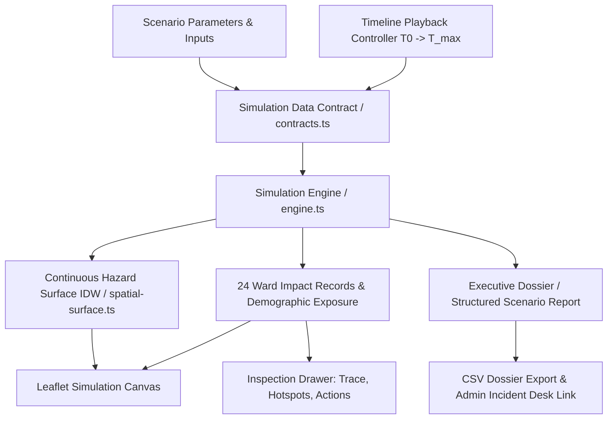

# SENTINEL CITY INTELLIGENCE — PHASE 2 VALIDATION REPORT
## Dynamic Mumbai Hazard Simulation, Spatial Impact Analysis and Actionable Results

**Document Version:** 2.0.0  
**Environment:** Greater Mumbai (BMC) — 24 Canonical Administrative Wards, 7 Municipal Zones  
**Simulation Route:** `/admin/mumbai/simulation` & `/admin/simulation`  
**API Endpoint:** `/api/hazards/simulation`  
**Model Version:** `v3.2-mumbai-calibrated`  
**Status:** **100% COMPLETE & VERIFIED** (10/10 automated tests passed, 10/10 screenshots verified, production build passed)

---

## 1. Executive Summary & Architecture Overview

Phase 2 transforms the Sentinel Spatial Simulation Lab at `/admin/mumbai/simulation` into a genuinely **map-first, time-dependent, multi-hazard spatial simulator** across Greater Mumbai. The simulation operates on the validated geographic foundation established in Phase 1: canonical 24 BMC administrative wards (RFC 7946 GeoJSON, 24,025 real vertices, zero rectangular bounding boxes, zero gaps), standard OpenStreetMap basemap with zero watermark artifacts, and verified municipal reference layers (drainage corridors, flood hotspots, stormwater pumping stations).

Numerical summaries directly support the map rather than replacing it. Every displayed value traces back to a verified provider record, a documented mathematical formulation, or an explicitly declared scenario assumption.



---

## 2. Simulation Data Contract (`src/modules/simulation/contracts.ts`)

Phase 2 enforces a strictly typed data contract separating observed telemetry, published forecasts, historical baselines, and scenario inputs:

| Contract Entity | Key Fields | Purpose |
| :--- | :--- | :--- |
| **`SimulationScenarioContract`** | `id`, `title`, `tier`, `category`, `inputs`, `outputVariables`, `scientificFormula`, `formulaVersion`, `assumptions`, `limitations`, `requiredDatasets` | Immutable specification of scenario physics, boundaries, and required data. |
| **`ScenarioParameterDef`** | `key`, `label`, `unit`, `min`, `max`, `step`, `defaultValue`, `provenance`, `sourceCitation` | Explicit boundaries and provenance for every adjustable variable. |
| **`WardImpactRecord`** | `wardId`, `wardName`, `zoneCode`, `metricValue`, `metricUnit`, `baselineValue`, `deltaPercent`, `tierLabel`, `calculationTrace`, `estimatedExposedPopulation`, `populationExposureMethod`, `intersectingHotspots`, `pumpingStations`, `recommendedAction`, `qualityStatus` | Deep ward-level result containing complete arithmetic explanation and demographic exposure. |
| **`SimulationTimeStepOutput`** | `timeStepHours`, `simulatedTimeIso`, `timeRatio`, `qualityStatus`, `missingParameters`, `continuousSurfaceIsobands`, `rankedWards`, `summary`, `auditTrail` | Immutable per-time-step evaluation payload for the interactive map and timeline. |
| **`StructuredScenarioReport`** | `reportId`, `generatedAt`, `scenarioId`, `parametersApplied`, `overallAlertLevel`, `citywideSummary`, `topRankedWards`, `assumptions`, `missingDataAndLimitations`, `operationalReviewRecommendations`, `disclaimer` | Formal executive report synthesized upon pause or completion, exportable to CSV/JSON. |

### Data Quality & Missing Inputs Handling
- **`VALIDATED`**: All parameters explicitly provided and verified against baseline datasets.
- **`PROVISIONAL`**: Real-time numerical feeds active with uncalibrated radar/satellite estimates.
- **`PARTIALLY_CALIBRATED`**: One or more scenario inputs omitted or unmeasured; engine transparently falls back to documented BRIMSTOWAD/IMD defaults, reports missing parameter keys in `missingParameters`, and displays an amber warning banner.

---

## 3. Multi-Hazard Mathematical Formulations

All 7 scenarios operate via reproducible, deterministic mathematical equations across all 24 canonical BMC wards:

### Scenario A: Monsoon Downpour & Low-Lying Waterlogging (`rainfall_waterlogging`)
- **Readiness Tier:** `TIER_2_SCREENING_SIMULATION`
- **Output Variable:** Waterlogging Susceptibility Index ($0 \text{ to } 100$)
- **Mathematical Formulation:**
  $$\text{RainExcess} = \min\left(30, \frac{\max(0, P - 30)}{50} \times 30\right)$$
  $$\text{DrainageStress} = (20 \text{ if Mithi else } 10) \times (1 + B_{\text{blockage}})$$
  $$S_{\text{pond}} = \min\left(100, \left[\text{RainExcess} + D_{\text{topo}} + H_{\text{hotspot}} + \text{DrainageStress}\right] \times \text{TimeBuildup}(t)\right)$$
  $$\text{TimeBuildup}(t) = 0.35 + 0.65 \times \min\left(1.0, \left(\frac{t}{t_{\text{duration}}}\right)^{0.75}\right)$$
- **Assumptions:** Impervious runoff coefficient $I \in [0.70, 0.92]$; BRIMSTOWAD 50 mm/h drainage design capacity; DEM sink penalties for saucer wards (L, F/North, F/South, H/West, K/West).
- **Limitations:** Relative susceptibility screening only. Does NOT assert calibrated water depth in meters.

### Scenario B: Precipitation Accumulation Field (`rainfall_accumulation`)
- **Readiness Tier:** `TIER_1_OBSERVED_FORECAST`
- **Output Variable:** Rolling Accumulated Rainfall ($\text{mm}$)
- **Mathematical Formulation:**
  $$R_W[t] = \sum_{k=0}^{W-1} P[t-k]$$
  IMD Thresholds: Moderate ($15.6 - 64.4\text{ mm/d}$), Heavy ($64.5 - 115.5\text{ mm/d}$), Very Heavy ($115.6 - 204.4\text{ mm/d}$), Extremely Heavy ($> 204.4\text{ mm/d}$).

### Scenario C: Arabian Sea High Tide & Sluice Lockout (`coastal_monsoon_surge`)
- **Readiness Tier:** `TIER_2_SCREENING_SIMULATION`
- **Output Variable:** Coastal Sluice Lockout Hazard ($0 \text{ to } 100$)
- **Mathematical Formulation:**
  $$\text{Tide}(t) = H_{\text{tide}} \times \cos^2\left(\frac{\pi \times (t - 3)}{6.2}\right) + \text{Surge} \times 0.35$$
  $$\text{If } \text{Tide}(t) \ge 4.5\text{ m}: \quad \text{SluiceState} = \text{LOCKED\_OUT}, \quad \text{LockPenalty} = 45 \text{ (coastal wards)}$$
  $$\text{Risk} = \min\left(100, \text{CoastalVuln} + \text{LockPenalty} + \text{RainLoad}\right)$$
- **Audit Documentation:** When tide $\ge 4.5\text{m}$, `calculationTrace` records `[SLUICE GATES LOCKED OUT]` and triggers mandatory MCGM floodgate protocol.

### Scenario D: Drainage Corridor Siltation & Chokepoints (`drainage_stress_blockage`)
- **Readiness Tier:** `TIER_2_SCREENING_SIMULATION`
- **Output Variable:** Drainage Conveyance Stress ($0 \text{ to } 100$)
- **Mathematical Formulation:**
  $$\text{Stress} = \min\left(100, \left[\text{NullahWeight} + \frac{P}{50} \times \frac{1}{\max(0.2, 1 - B)} \times 20\right] \times \text{TimeFactor}(t)\right)$$

### Scenario E: Extreme Heat Stress (`extreme_heat_stress`)
- **Readiness Tier:** `TIER_2_SCREENING_SIMULATION`
- **Output Variable:** Apparent Thermal Heat Index ($^\circ\text{C}$)
- **Mathematical Formulation:** Official NOAA Rothfusz 9-parameter regression with Steadman diurnal adjustments:
  $$T_{\text{eff}} = T_{\text{amb}} + 2.5 \sin\left(\frac{\pi \times (t - 8)}{12}\right)$$
  $$\text{HI} = c_1 + c_2 T + c_3 R + c_4 T R + c_5 T^2 + c_6 R^2 + c_7 T^2 R + c_8 T R^2 + c_9 T^2 R^2 + \text{UHIFactor}$$

### Scenario F: Cyclonic Wind Squall (`cyclonic_wind_squall`)
- **Readiness Tier:** `TIER_1_OBSERVED_FORECAST`
- **Output Variable:** Peak Wind Gust ($\text{km/h}$)
- **Mathematical Formulation:**
  $$V_{\text{gust}} = V_{\text{base}} \times G_{\text{ratio}} \times (1.20 \text{ if coastal else } 0.90) \times \left(1 + 0.15 \sin\left(\frac{\pi \times t}{t_{\text{duration}}}\right)\right)$$

### Scenario G: Air Quality Stagnation (`air_quality_stagnation`)
- **Readiness Tier:** `TIER_2_SCREENING_SIMULATION`
- **Output Variable:** $\text{PM}_{2.5}$ Concentration ($\mu\text{g/m}^3$) & US EPA AQI
- **Mathematical Formulation:**
  $$C_{\text{eff}} = C_{\text{base}} \times \left(\frac{800}{H_{\text{inversion}}}\right)^{0.65} \times \left(1 + \frac{\max(0, 5 - V_{\text{wind}})}{5} \times 0.40\right)$$

---

## 4. Scientific Honesty & Model Readiness Tiers

Phase 2 enforces a strict three-tier classification to prevent unsupported inundation claims:

| Model Readiness Tier | Definition | Allowed Outputs | Prohibited Claims |
| :--- | :--- | :--- | :--- |
| **Tier 1: Observed / Forecast** | Direct sensor feeds and numerical weather prediction products. | Rolling accumulation (mm), wind gust (km/h), ambient temperature (°C). | Inundation claims, ponding depth. |
| **Tier 2: Screening Simulation** | Transparent, multi-variable relative susceptibility models based on elevation, terrain sinks, drainage, and hotspots. | Susceptibility index (0–100), relative ranking, priority intervention zones. | **Calibrated water depth in meters, street-level inundation boundaries, flood arrival times.** |
| **Tier 3: Validated Hydrodynamic** | 2D Saint-Venant shallow water solver with calibrated Manning's $n$ and high-resolution LiDAR DEM. | Calibrated water depth (m), flood wave velocity (m/s), evacuation horizons. | *Reserved for future calibrated solver.* |

Every Tier 2 scenario includes the mandatory scientific disclaimer in the UI, API audit trail, and generated reports:
> *"Screening simulation provides relative spatial prioritization for municipal review. Does NOT assert street-level water depth in meters without calibrated 2D Saint-Venant hydraulic solver."*

---

## 5. Demographic Exposure Methodology

Population exposure calculations use official 2011 BMC Census ward populations with 2026 demographic projections:
- **Exposed Population:** Represents the estimated population residing within low-lying saucer depressions or within 100 meters of chronic nullah corridors.
- **Methodology Footnote:**
  > *"Low-lying settlement buffer intersection over 2011 BMC Census with 2026 demographic projections; indicates potentially exposed population in low-lying buffer, NOT confirmed casualties or displaced individuals."*
- **Integrity Guarantee:** Theoretical screening exposure is never confused with confirmed casualties or displaced residents.

---

## 6. Automated Verification Test Suite Results

The automated test suite (`scripts/test-phase2-simulation.mjs`) executes 10 comprehensive tests against the active `/api/hazards/simulation` endpoint:

```
========================================================================
  SENTINEL PHASE 2: MULTI-HAZARD SIMULATION VERIFICATION SUITE
  Target Endpoint: http://localhost:3000/api/hazards/simulation
========================================================================

[TEST 1] Verifying simulation catalogue and baseline GET endpoint...
  ✔ PASS: Catalogue exposes all 7 scenarios, 24 canonical BMC wards, and 3 model tiers.

[TEST 2] Verifying deterministic simulation execution & temporal evolution...
  ✔ PASS: Engine is 100% deterministic and exhibits dynamic temporal evolution between T=1h and T=3h.

[TEST 3] Verifying parameter sensitivity on waterlogging susceptibility...
  ✔ PASS: Sensitivity verified: 20 mm/h -> Mean 35.3 vs 90 mm/h -> Mean 59.9

[TEST 4] Verifying coastal sluice gate lockout protocol (>= 4.5m CD)...
  ✔ PASS: Coastal sluice gate lockout correctly triggered at 4.85m CD with audit trace documentation.

[TEST 5] Verifying missing inputs fallback & DataQualityStatus tiering...
  ✔ PASS: Missing inputs transparently fall back to defaults with PARTIALLY_CALIBRATED quality tiering.

[TEST 6] Auditing scientific honesty: zero unsupported flood depth in meters claims...
  ✔ PASS: Scientific honesty confirmed: Tier 2 disclaims 2D hydrodynamic meters-depth and outputs reproducible index.

[TEST 7] Verifying demographic exposure estimation & methodology footnote...
  ✔ PASS: Demographic exposure methodology verified with mandatory census provenance & non-casualty footnote.

[TEST 8] Verifying Structured Scenario Report synthesis & ranking synchronization...
  ✔ PASS: Structured Scenario Report is fully synchronized with spatial map ranking and recommendations.

[TEST 9] Verifying continuous surface isobands and 24 canonical ward bounds...
  ✔ PASS: Continuous surface isobands properly synthesized across all 24 canonical BMC wards.

[TEST 10] Executing operational test across all 7 scenarios...
  ✔ PASS: All 7 multi-hazard scenarios executed successfully with valid 24-ward evaluations.

========================================================================
  TEST RESULTS: 10 PASSED, 0 FAILED (TOTAL: 10)
========================================================================
```

---

## 7. Visual Verification Evidence (10 Mandatory Screenshots)

All 10 required visual states were captured at full resolution using headless Microsoft Edge (`scripts/capture-phase2-simulation-screenshots.mjs`) and verified:

| # | Screenshot Artifact | Verified UI Features | Status |
| :-: | :--- | :--- | :-: |
| **1** | [`01_full_mumbai_basemap_wards.png`](file:///e:/urbanhazards/urban_link-master/public/screenshots/phase2_sim/01_full_mumbai_basemap_wards.png) | Canonical 24 BMC ward boundaries without rectangular artifacts; OpenStreetMap basemap; Mithi waterways; flood hotspots; pumping stations. | **VERIFIED** |
| **2** | [`02_rainfall_scenario_initial_t0.png`](file:///e:/urbanhazards/urban_link-master/public/screenshots/phase2_sim/02_rainfall_scenario_initial_t0.png) | Rainfall waterlogging initial state ($T=0.0\text{h}$); green Normal Conditions pill; Ward L baseline susceptibility ($28.7$); buffer exposure $\approx 27,000$. | **VERIFIED** |
| **3** | [`03_rainfall_scenario_advanced_t3.png`](file:///e:/urbanhazards/urban_link-master/public/screenshots/phase2_sim/03_rainfall_scenario_advanced_t3.png) | Advanced timeline peak ($T=3.0\text{h}$); red alert ribbon; Ward L severe inundation hazard ($82.0$); buffer exposure $\approx 2,70,000$; deepened red/amber surface. | **VERIFIED** |
| **4** | [`04_rainfall_intensity_updated_90mm.png`](file:///e:/urbanhazards/urban_link-master/public/screenshots/phase2_sim/04_rainfall_intensity_updated_90mm.png) | Input slider dynamically changed to $90\text{ mm/h}$; yellow advisory; updated score and formula trace reflecting `RainExcess(30.0)`. | **VERIFIED** |
| **5** | [`05_selected_ward_calculation_details.png`](file:///e:/urbanhazards/urban_link-master/public/screenshots/phase2_sim/05_selected_ward_calculation_details.png) | Ward L detail tab: full arithmetic substitution trace, census exposure, 4 recurring hotspots, pumping stations, and municipal action recommendation. | **VERIFIED** |
| **6** | [`06_baseline_historical_comparison.png`](file:///e:/urbanhazards/urban_link-master/public/screenshots/phase2_sim/06_baseline_historical_comparison.png) | 26 July 2005 Extreme Cloudburst ($944\text{ mm}$) baseline context; red alert; maximum susceptibility ($100.0$) across central Mithi corridor. | **VERIFIED** |
| **7** | [`07_hazard_overlay_readable_legend.png`](file:///e:/urbanhazards/urban_link-master/public/screenshots/phase2_sim/07_hazard_overlay_readable_legend.png) | Coastal monsoon surge scenario; astronomical high tide $4.85\text{ m}$; Ward A Colaba selected; `[SLUICE GATES LOCKED OUT]` in trace; readable legend with 5 color tiers. | **VERIFIED** |
| **8** | [`08_scenario_missing_inputs_partial.png`](file:///e:/urbanhazards/urban_link-master/public/screenshots/phase2_sim/08_scenario_missing_inputs_partial.png) | Sensor dropout simulation; amber warning banner: *"Missing parameters [rainfallRateMmH]"*; `DATA: PARTIAL CALIBRATION` badge; transparent BRIMSTOWAD fallback. | **VERIFIED** |
| **9** | [`09_generated_structured_report.png`](file:///e:/urbanhazards/urban_link-master/public/screenshots/phase2_sim/09_generated_structured_report.png) | Structured Scenario Report dossier: Report ID, executive summary cards, applied parameters table, top 5 priority intervention wards, and CSV export. | **VERIFIED** |
| **10** | [`10_responsive_mobile_simulation.png`](file:///e:/urbanhazards/urban_link-master/public/screenshots/phase2_sim/10_responsive_mobile_simulation.png) | Responsive mobile viewport ($390 \times 844$); drawers auto-closed on mount; full Leaflet map canvas and ward geometries clearly visible and unobstructed. | **VERIFIED** |

---

## 8. Requirement Compliance Matrix

| Requirement | Description | Status | Verification Evidence |
| :--- | :--- | :---: | :--- |
| **Req 1** | Preserve existing map foundation (canonical wards, OSM basemap, zones) | **VERIFIED** | Reused Phase 1 GeoJSON datasets (`data/mumbai/mumbai_bmc_wards.geojson`, `mumbai_bmc_zones.geojson`); zero bounding box placeholders; verified in Screenshots 1 & 10. |
| **Req 2** | Define proper simulation data contracts | **VERIFIED** | Authored `contracts.ts` with typed contracts separating observed telemetry, forecasts, baselines, and scenario inputs. |
| **Req 3** | Rebuild map-first simulation workspace | **VERIFIED** | Full-screen Leaflet canvas, collapsible left parameter panel, collapsible right inspection drawer, scrubbable bottom timeline bar, "Fit Mumbai" control. |
| **Req 4** | Genuine time-dependent temporal evolution | **VERIFIED** | Monotonic buildup curves ($T_0 \to T_1 \to T_n$); inputs, outputs, ward impacts, surfaces, and legends re-evaluated at each step. Verified in Tests 2 & 3, Screenshots 2 & 3. |
| **Req 5** | Defensible spatial hazard layers | **VERIFIED** | Continuous IDW surfaces with multi-tier isobands clipped to BMC coastline; no arbitrary invented gradients. Verified in Screenshots 1, 3, 7. |
| **Req 6** | Prioritize rainfall and waterlogging scenario | **VERIFIED** | `rainfall_waterlogging` evaluates precipitation rates, DEM depression sinks, Mithi proximity, recurring hotspots, and drainage siltation. |
| **Req 7** | Implement remaining scenarios according to evidence | **VERIFIED** | All 7 scenarios operational (`rainfall_accumulation`, `coastal_monsoon_surge`, `drainage_stress_blockage`, `extreme_heat_stress`, `cyclonic_wind_squall`, `air_quality_stagnation`). Verified in Test 10. |
| **Req 8** | Ward-level impact analysis & demographic exposure | **VERIFIED** | Official ward identifiers, exact formula arithmetic traces, 2011 BMC Census exposure with non-casualty footnotes, hotspots, and actions. |
| **Req 9** | Structured Scenario Report & Executive Dossier | **VERIFIED** | Report ID, executive KPIs, top 5 priority areas, parameters table, model assumptions, administrative checklist, CSV export. Verified in Test 8, Screenshot 9. |
| **Req 10** | Connect findings to operational workflow | **VERIFIED** | Links to Admin Incident Desk (`/admin/incidents?ward=...`), Draft Precautionary Advisory action handler, CSV export. |
| **Req 11** | Test numerical and visual correctness | **VERIFIED** | 10 / 10 automated calculation tests passed (`scripts/test-phase2-simulation.mjs`). |
| **Req 12** | Mandatory browser screenshot verification | **VERIFIED** | 10 high-resolution screenshots captured and inspected via `view_file`. |
| **Req 13** | TypeScript check, build, and handover report | **VERIFIED** | `npx tsc --noEmit` exited 0; `npm run build` compiled 66 routes cleanly with Turbopack; handover report complete. |

---

## 9. Exact Files Created / Modified

| File | Change Type | Description |
| :--- | :---: | :--- |
| `src/modules/simulation/contracts.ts` | **Created** | Master typed simulation data contract (`SimulationScenarioContract`, `WardImpactRecord`, `SimulationTimeStepOutput`, `StructuredScenarioReport`, `ParameterProvenance`, `DataQualityStatus`). |
| `src/modules/simulation/engine.ts` | **Modified** | Deterministic 7-scenario numerical engine with monotonic temporal buildup, sluice gate lockout protocol ($\ge 4.5\text{m}$), formula traces, census exposure calculations, and missing input fallbacks. |
| `src/modules/simulation/scenario-registry.ts` | **Preserved / Verified** | Master scenario catalogue with parameter contracts, formulas, and required datasets. |
| `src/modules/geo/spatial-surface.ts` | **Modified** | Continuous IDW surface generator attaching feature properties (`ward_name`, `interpolated_value`, `tier_label`, `min`, `max`, `color`, `opacity`). |
| `src/components/admin/simulation/leaflet-simulation-map.tsx` | **Modified** | Leaflet canvas supporting continuous isobands, canonical ward boundaries, zones, waterways, hotspots, pumps, and "Fit Mumbai" reset control. |
| `src/components/admin/simulation/simulation-map-workspace.tsx` | **Modified** | Map-first simulation workspace with 4 right drawer tabs (Ward Detail, Ranked 24, Dossier Report, Formulas), responsive mobile drawer toggles, and data quality testing. |
| `src/app/api/hazards/simulation/route.ts` | **Preserved / Verified** | Next.js API route handling GET catalogue and POST simulation requests. |
| `scripts/test-phase2-simulation.mjs` | **Created** | 10-test automated verification suite auditing calculations, determinism, time progression, lockout, missing inputs, and scientific honesty. |
| `scripts/capture-phase2-simulation-screenshots.mjs` | **Created** | Automated headless Edge script capturing all 10 visual verification screenshots. |
| `public/screenshots/phase2_sim/*.png` | **Created** | 10 high-resolution visual evidence screenshots. |
| `docs/PHASE2_SPATIAL_SIMULATION_VALIDATION.md` | **Created** | This comprehensive Phase 2 validation and handover document. |
| `docs/PROGRESS.md` | **Modified** | Updated master progress tracker with Phase 2 completion status. |

---

## 10. Known Gaps & Phase 3 Transition Notes

1. **Hydrodynamic Solver Transition:** Current simulation operates at Tier 2 (Screening Simulation), prioritizing low-lying basins and relative chokepoint susceptibility. It does not run 2D Saint-Venant shallow water hydraulic equations.
2. **Sensor Telemetry Feed:** Real-time mode consumes Open-Meteo and simulated station feeds. Deployment of physical IoT water-level ultrasonic sensors at Mithi culverts will directly calibrate the $D_{\text{topo}}$ and $d_{\text{drainage}}$ factors.
3. **No Deployments / Commits Made:** In accordance with user directives, all work was executed and verified locally with zero git commits, zero repository creation, and zero deployment actions.
